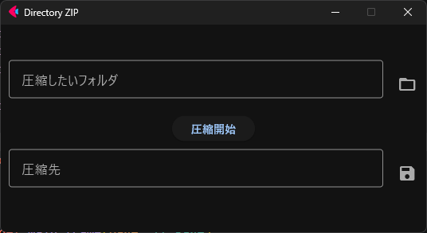

# Directory ZIP

フォルダを選んでボタンを押すだけで ZIP 圧縮できる、Python + Flet のデスクトップ GUI ツールです。


<!-- スクリーンショット: アプリを起動して画面を撮影し、docs/screenshot.png に置いてください -->

## できること

- フォルダピッカーで圧縮したいフォルダを選択（選択したフォルダ名から ZIP ファイル名を自動提案）
- 保存先ダイアログで圧縮先を指定（`.zip` 拡張子がなければ自動で付与）
- 圧縮中はプログレス表示 + ボタンを無効化し、処理は別スレッドで実行するので GUI が固まらない
- 完了 / 失敗 / 未選択をダイアログで通知

## 技術スタック

- Python
- [Flet](https://flet.dev/) — GUI
- `shutil.make_archive` / `asyncio.to_thread` — 圧縮処理の非同期実行

## 実行方法

```bash
pip install -r requirements.txt
python main.py
```

## 工夫した点

- 重い圧縮処理を `asyncio.to_thread` で別スレッド化し、UI スレッドをブロックしないようにした
- 圧縮中の二重クリック防止（ボタン無効化）と、処理中であることが分かるプログレス表示
- 保存先の拡張子チェックなど、使う人が迷わない細かい入力補助

## ライセンス

MIT
